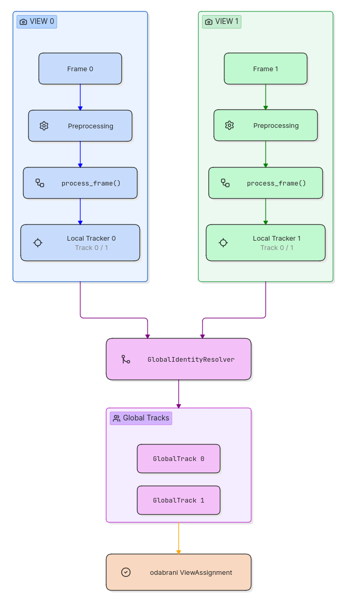

# Automatic sparring analysis from multi-camera videos using computer vision

Master's thesis project which explores application of computer vision for analysis of boxing sparring videos. The system implements person tracking in single camera mode (**single-view**) and combines results from multiple cameras (**multi-view**). Special emphasis is placed on maintaining boxers identity during movement, occlusion, temporary detection loss, as well as on evaluating tracking performance against ground-truth data.


## 🧠 Architecture



In multi-view every camera angle goes through image preprocessing, boxer and keypoint detection, glove ROI localization, and appearance feature extraction. Then Local tracker uses the recived spacial data and appearance feature to differentiate boxers and maintain their identities. Module `GlobalIdentityResolver` combines the results of local trackers from every camera angle and controls view assigment to build and maintain global identity.

The system is designed using a modular architecture, so that every phase in the processing pipeline can be individually analysed and debugged. Such design is very usefull, since errors in earlier phases, such as inaccurate wrist keypoint detection or incorrectly extracted appearance feature, can affect local tracker and consequently global identity. 

The modular design also allows additional cameras to be intergrated without requiring major changes to the existing implementation. This makes the multi-view system easier to extend and evaluate with different numbers of camera views.


## Main steps

- **Preprocessing (`preprocessing/`)** – video frames preprocessing with CLAHE (Contrast Limited Adaptive Histogram Equalization) and temporal smoothing between frames
- **Pose detection (`detection/`)** – boxer and keypoint detection using YOLO pose model
- **Glove extraction (`utils/`)** – glove ROI localization based on wrist keypoint and appearance feature (glove color) extraction 
- **Single-view tracking (`tracking/`)** – maintaining boxer identities with local trackers, which combine spatial information, detected by YOLO model, and appearance feature. Appearance feature is implemented as online learning model for detecting and maintaining information of dominate glove color 
- **Multi-view identity resolution (`multiview/`)** – combines the results of local trackers from every camera angle and controls view assignment to build and maintain global identiety of every boxer
- **Evaluation (`evaluation/`)** – evaluation using reference data defined in ground_truth_*.py folders.
- **Visualization (`utils/`)** – system vizaulization of detections, keypoints, glove ROIs, local tracker states, and view selected for each global identity 


## 📁 Structure

```text
DIPLOMSKI-RAD/
├── detection/
| └── pose_detector.py
| 
├── docs/
| └── multi_view_pipeline.png
|
├── evaluation/
| ├── ground_truth_1_0.py
| ├── ground_truth_1_1.py
| ├── ground_truth_2_0.py
| ├── ground_truth_2_1.py
| ├── metric.py
| ├── multiview_ground_truth_1.py
| ├── multiview_ground_truth_2.py
| ├── multiview_metrics.py
| └── print_view_metrics.py
|
├── multiview/
| ├── global_identity_resolver.py
| ├── global_track.py
| └── view_assignment.py
|
├── preprocessing/
| ├── preprocessing.py
| └── temporal.py
|
├── tracking/
| ├── color_model.py
| ├── track.py
| └── tracker.py
|
├── utils/
| ├── glove_extraction.py
| └── visualization.py
|
├── main.py
├── run.sh
├── requirements.txt
└── README.md
```

## ⚙️ Installation

Use Python virtual environment.

### 1. Clone repository

```bash
git clone https://github.com/kovacFico/DIPLOMSKI-RAD.git
cd DIPLOMSKI-RAD
```

### 2. Virtual environment

Linux/macOS:

```bash
python3 -m venv .venv
source .venv/bin/activate
```

Windows:

```powershell
python -m venv .venv
.venv\Scripts\activate
```

### 3. dependency installation

```bash
pip install -r requirements.txt
```

## Sparring videos

Sparring videos aren't included due to size.
To run the system, place the videos in the root folder, and adjust the paths in main.py.

## ▶️ Running

Firstly, system parameter need to be adjusted in the main.py.

### 🔧 Configuration

```bash
CONF_THRESHOLD = 0.4

VIDEO_PATH_SINGLE = "runda2-1.mp4" 
VIDEO_PATH_MULTI = [
    "runda2-0.mp4",
    "runda2-1.mp4"
]

MODE = 'multi'  # 'single' ili 'multi'
EVALUATE = true  
SHOW_DEBUG = true
```

#### Single-view

```bash
MODE="single"
VIDEO_SINGLE="runda2-1.mp4"
```

#### Multi-view

```bash
MODE="multi"
VIDEO_PATH_MULTI = [
    "runda2-0.mp4",
    "runda2-1.mp4"
]
```

#### Debug visualization

```bash
SHOW_DEBUG=true
```

To run the system without visualization

```bash
SHOW_DEBUG=false
```

#### Evaluation

```bash
EVALUATE=true
```

To run the system without evaluation

```bash
EVALUATE=false
```


## Evaluation

System supports individual evaluation of single-view and multi-view mode.

Single-view evaluation uses:

- `IdentityEvaluator`
- `CoverageEvaluator`

Multi-view evaluation uses:

- `MultiViewIdentityEvaluator`


## 📌 Notes

System uses YOLO pose model:

```text
yolo11n-pose.pt
```

Model must be available in the working dir.
System implies: 
1. boxers have different colored gloves
2. in multiview, given videos are already synchronized, that is system doesn't check if received frames are showing the same moment in sparring

